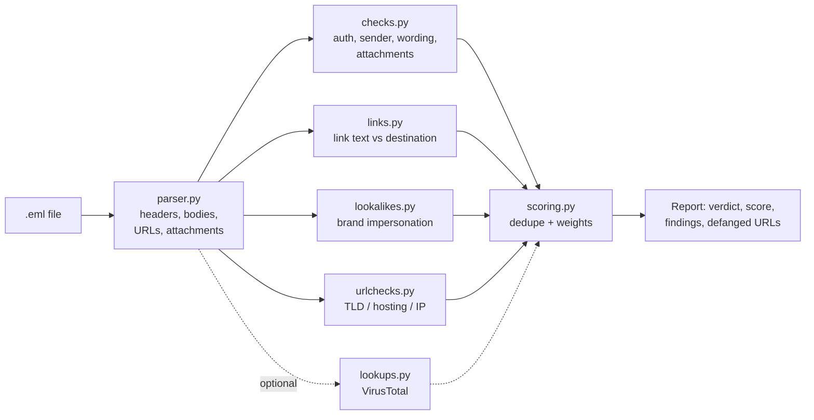

# phishscan

[](https://github.com/daroman003/phishscan/actions/workflows/tests.yml)

A command-line phishing email analyzer written in Python. Give it an `.eml` file and it
parses the headers, links and attachments, runs 25+ detection checks, and returns a
0-100 risk score with a plain-English explanation of every finding.

Built as a learning project and tested against real phishing emails from the
[phishing_pot](https://github.com/rf-peixoto/phishing_pot) honeypot corpus and against
real legitimate mail, with the tuning process documented in [TUNING.md](TUNING.md).

> **Safety:** phishscan only *reads* emails. It never opens attachments, never visits
> links, and prints every URL defanged (`hxxps://evil[.]com`) so nothing is clickable.

## Example

```
$ python -m phishscan samples/test1.eml
=== phishscan report: samples/test1.eml ===
Verdict: LIKELY PHISHING  (score 100/100)
From:    PayPal Support <support@paypa1-secure.example.com>
Subject: Urgent: Your account has been limited

Findings (9):
  [HIGH  ] spf_fail: SPF failed: sending server is not authorized for this domain
  [HIGH  ] dmarc_fail: DMARC failed: the message does not align with the sender domain's policy
  [HIGH  ] display_name_spoof: Display name says 'PayPal Support' but the address is on example.com
  [HIGH  ] double_extension: 'invoice.pdf.exe' pretends to be a .pdf file but is really .exe
  [HIGH  ] link_text_mismatch: Link shows 'hxxps://www[.]paypal[.]com/signin' but goes to hxxp://paypa1-secure[.]example[.]com/login
  [HIGH  ] lookalike_domain: From address: paypa1-secure[.]example[.]com imitates 'paypal' with swapped characters, ...
  [MEDIUM] reply_to_mismatch: Replies go to example.org, not the sender's domain example.com
  [LOW   ] return_path_mismatch: Bounce address domain example.net differs from From domain example.com ...
  [LOW   ] urgent_language: Pressure wording found: 'urgent', 'within 24 hours', 'account has been', ...
```

The sample emails in `samples/` are fake and written for testing.

## What it checks

| Area | Checks |
|---|---|
| **Authentication** | SPF, DKIM and DMARC failures; missing authentication results |
| **Sender** | From / Reply-To / Return-Path mismatches; business sender whose replies go to free webmail; display name claiming a brand the address doesn't belong to; brand named in the subject by an unrelated sender; invalid or randomly generated sender domains; missing sender address |
| **Links** | Link text that shows one site while the link goes to another; URL shorteners; known email-marketing click trackers and links to the sender's own domain (both trusted only if the sender passed DMARC) |
| **Lookalike domains** | Character swaps (`paypa1`), `rn` for `m`, brand names inside other domains, brand used as a subdomain of another site (`paypal.com.evil.net`), typo-squats, punycode |
| **URL patterns** | Throwaway TLDs (`.store`, `.site` ...), free hosting platforms (`run.app`, `github.io` ...), raw IP addresses in hostnames, IP addresses disguised as a single number (`http://2997024026/`) |
| **Attachments** | Double extensions (`invoice.pdf.exe`), executables and scripts, macro-enabled Office files, archives and disk images; SHA-256 hashing |
| **Wording** | Pressure and account-lure phrases; advance-fee / prize scam wording |
| **Reputation (optional)** | VirusTotal lookups for attachment hashes and URLs (`--vt`) |

Malformed URLs (common in real phishing) are handled safely: a broken link is skipped,
never allowed to crash the scan.

## How it works



Every check returns findings in the same shape (`check`, `severity`, `detail`), so adding a
new rule never requires touching the scoring code.

**Scoring:** high = 30, medium = 15, low = 5 points, capped at 100.
60+ is **LIKELY PHISHING**, 30-59 is **SUSPICIOUS**, below 30 is **LOW RISK**.
Weak signals (such as a bounce-address mismatch, which legitimate bulk mailers cause) are
deliberately low so they only matter in combination.

## Installation

Developed and tested on Python 3.13.

```bash
git clone https://github.com/daroman003/phishscan.git
cd phishscan
python -m venv .venv
# Windows PowerShell:  .venv\Scripts\Activate.ps1
# macOS / Linux:       source .venv/bin/activate
pip install -r requirements.txt
```

`requirements.txt` holds only what phishscan needs to run. To run the tests as well,
install the development requirements instead (they include the runtime ones):

```bash
pip install -r requirements-dev.txt
```

## Usage

```bash
python -m phishscan samples/test1.eml            # readable report
python -m phishscan samples/test1.eml --json     # full result as JSON
python -m phishscan samples/test1.eml --vt       # add VirusTotal lookups (needs API key)
```

**Batch mode** scans a whole folder, writes a CSV, and prints accuracy numbers:

```bash
python -m phishscan.batch samples/phishing --label phishing --out results.csv
python -m phishscan.batch samples/legit --label legit --out results.csv --append
```

**Triage mode** summarizes the emails the tool scored LOW RISK so you can study the misses:

```bash
python -m phishscan.triage samples/phishing --limit 15
```

**Building a legitimate set:** export a mail folder (e.g. with Google Takeout) and split it:

```bash
python tools/mbox_to_eml.py path/to/export.mbox samples/legit
```

**VirusTotal (optional):** create a free account, then put your key in a `.env` file:
`VT_API_KEY=your-key-here`. Lookups only ask whether VirusTotal has already seen a hash or
URL. Nothing is uploaded or submitted, and results are cached.

## Evaluation

Tested on real phishing from the phishing_pot honeypot corpus and on real legitimate
email exported from a personal inbox. The sample folders are not in the repo.

| Set | Emails | Result |
|---|---|---|
| Tuning set (random sample from phishing_pot, used while writing rules) | 498 | 354 detected (71%) |
| **Holdout set** (separate random sample, not used to write rules) | 50 | **35 detected (70%)** |
| Legitimate email (newsletters, alerts, marketing, job alerts; 37 senders, 29 domains) | 76 | **0 false positives**, down from 7 (9%) before the Round 4 fixes |

"Detected" means a verdict of SUSPICIOUS or LIKELY PHISHING. The holdout row is the honest
number: the rules were written after studying the tuning set, so that set's result is
optimistic. The holdout was checked for duplicates against the tuning set by content and
Message-ID, and the two that turned up were removed from the tuning set.

The legitimate set has the same caveat: its 0 false positives was reached by fixing the
7 it started with, so it is a tuning result, not an independent one. Fresh legitimate
mail is the best next test. The Round 4 fixes did not change a single verdict on either
phishing set. See [TUNING.md](TUNING.md) for every change and the reason for it.

## Limitations

- **Hand-weighted rules, not machine learning.** The weights are tuned by hand, and a small
  legitimate-mail set means the false-positive rate is only an estimate.
- **Some phishing has no technical tell.** Plain-text scams and marketing-style spam from
  clean domains can pass every check.
- **English-centric wording rules.** Pressure and scam phrases are English only; several
  missed samples were German, Spanish or Portuguese.
- **Honeypot samples have stripped authentication headers**, so the header checks are
  under-represented in the phishing results. Real inbox mail carries them.
- **Trusted click-tracking redirects can be abused.** An attacker using a marketing service
  and passing DMARC on their own domain gets less scrutiny on tracked links.
- **No dynamic analysis.** Links are never followed, attachments never opened, and
  images/QR codes are not analyzed. This is by design for safety.

## Project structure

```
phishscan/
  parser.py       read .eml files: headers, bodies, URLs, attachment hashes
  checks.py       authentication, sender, wording and attachment checks
  links.py        link text vs destination, shorteners, tracker redirects
  lookalikes.py   brand impersonation and lookalike domains
  urlchecks.py    throwaway TLDs, free hosting, IP and encoded-IP hostnames
  lookups.py      optional VirusTotal reputation lookups
  scoring.py      dedupe findings, weights, verdict
  batch.py        folder scan, CSV output, accuracy summary
  triage.py       summaries of missed emails for rule tuning
  __main__.py     command-line entry point
tests/            pytest suite (55 tests)
tools/
  mbox_to_eml.py  split a mailbox export (e.g. Gmail Takeout) into .eml files, skipping duplicates
samples/          fake test emails
TUNING.md         log of every tuning change
```

## Tests

```bash
pip install -r requirements-dev.txt
python -m pytest -v
```

The suite uses only the fake emails in `samples/` and messages built inside the tests,
so it needs no private data or network access. GitHub Actions runs it on every push and
pull request ([workflow](.github/workflows/tests.yml)).

## Disclaimer

For education and defensive security research. phishscan produces a risk estimate, not a
guarantee. Don't rely on it as your only defense.
